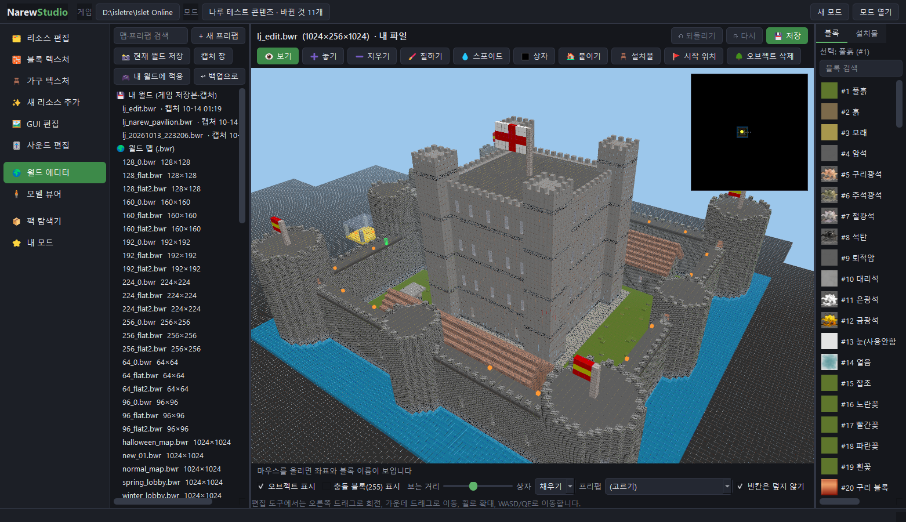
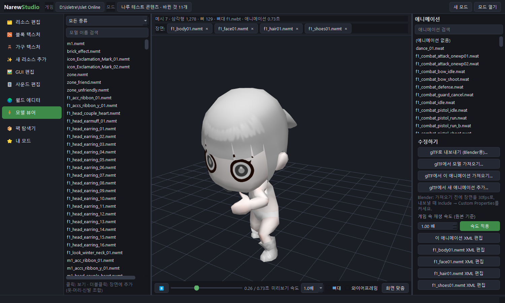
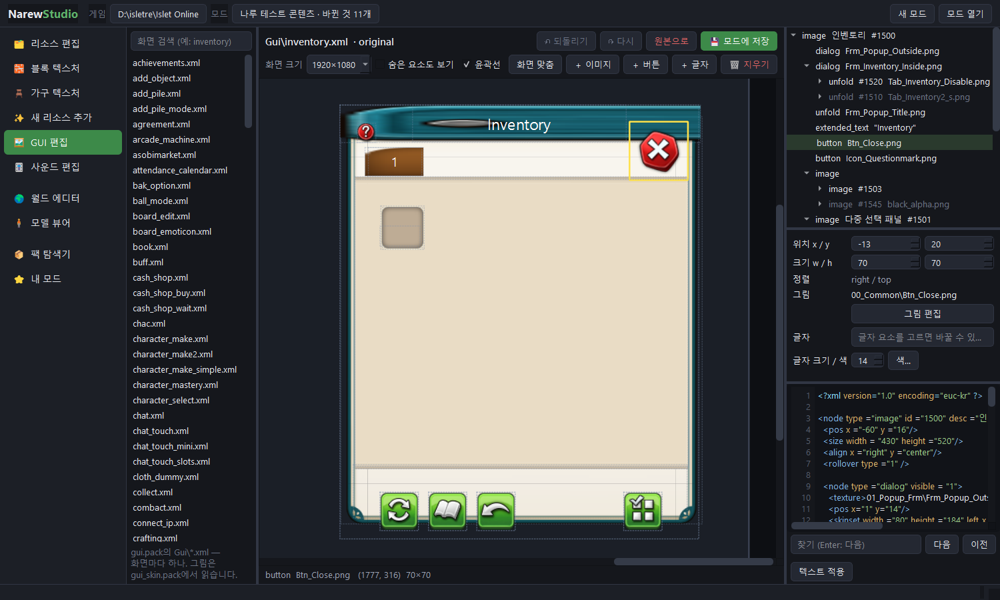
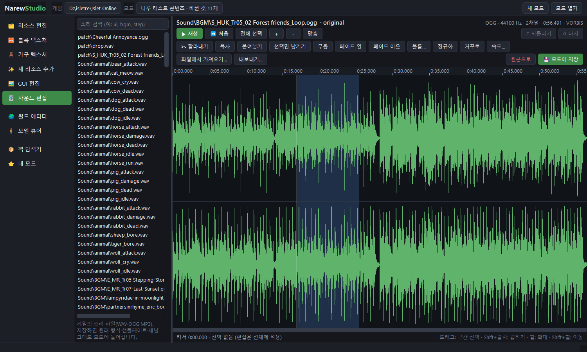
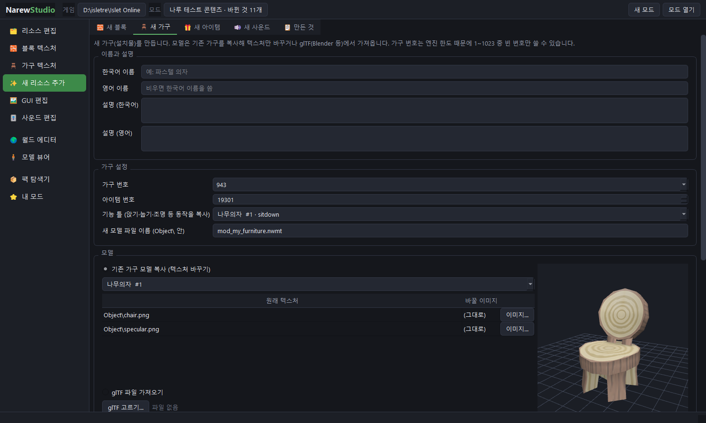
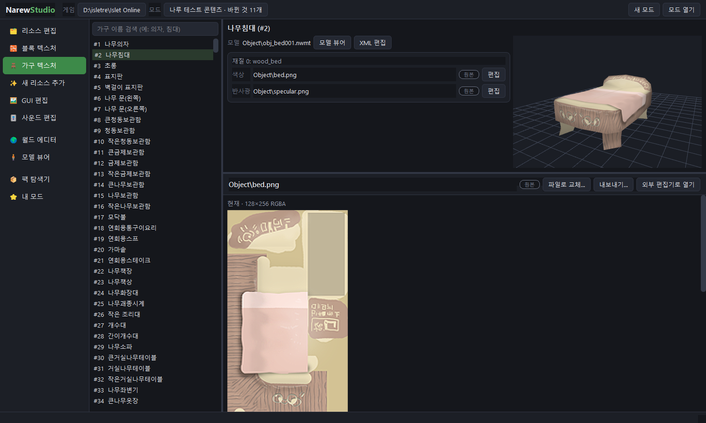
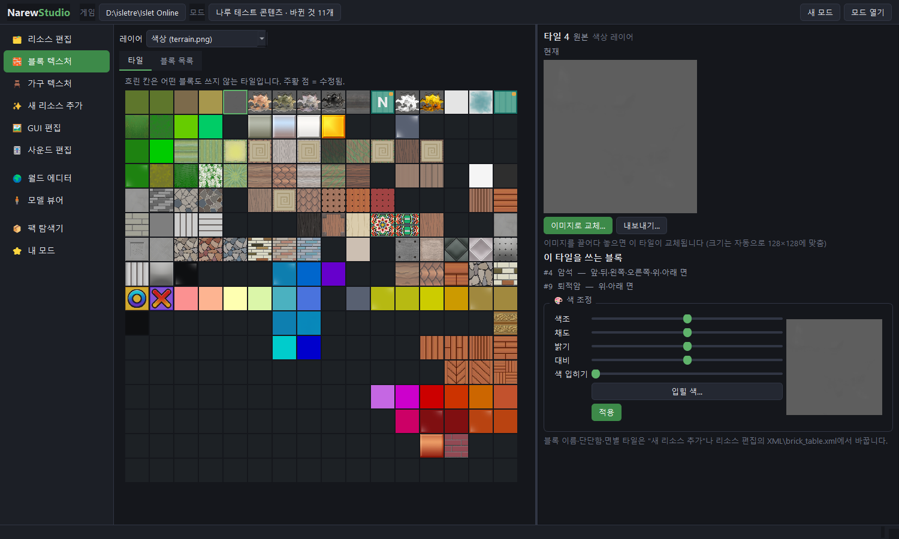
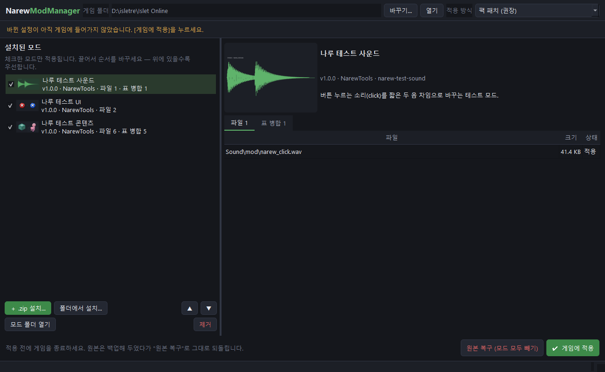
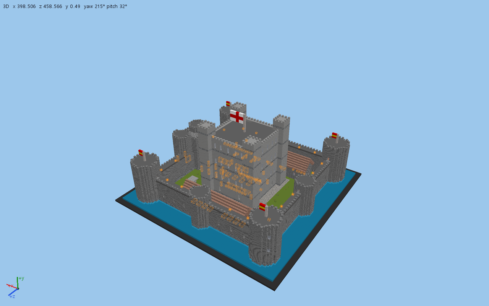
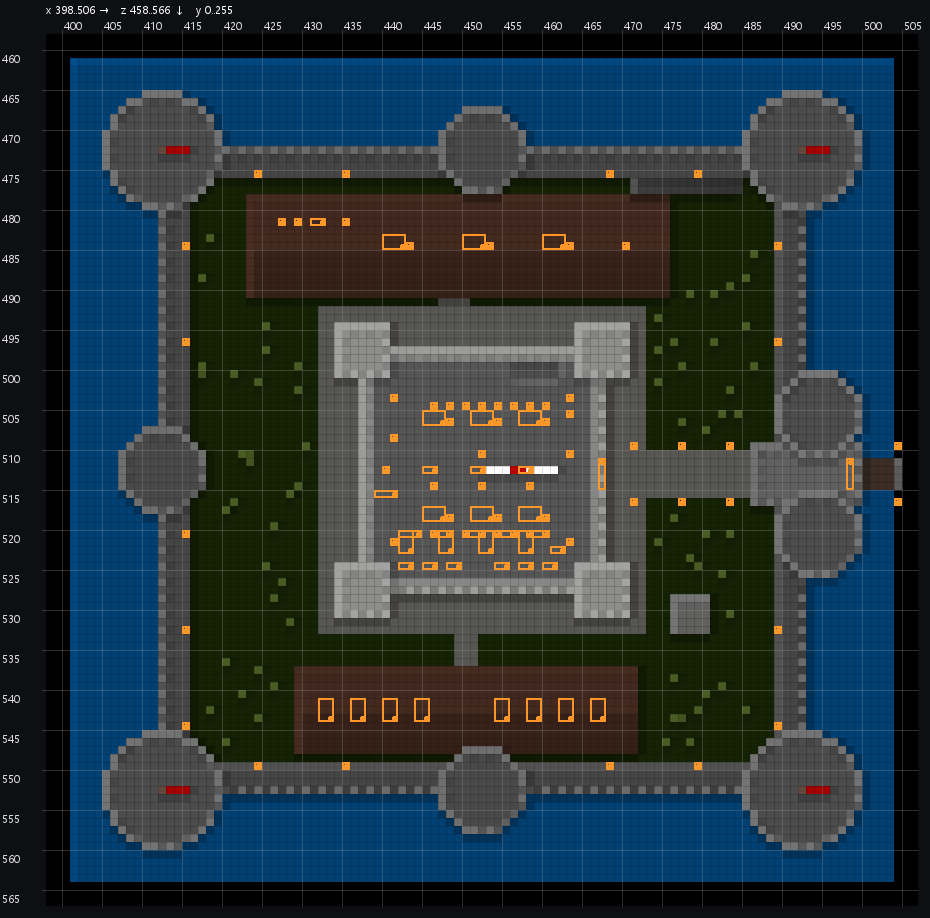

# NarewTools — Islet Online MOD ツールキット

[한국어](README.md) · [English](README.en.md) · [简体中文](README.zh-CN.md) · [繁體中文](README.zh-TW.md) · **日本語**

Islet Online（아일렛 온라인）の独自エンジン **NarewEngine2** を解析して作った、Windows 10/11 用の MOD ツール群です。
ゲームファイルを直接いじらずに、**MOD** としてブロック・家具・アイテム・サウンドを追加したり、テクスチャ・GUI 画面・音・モデル・ワールド（マップ）を編集したりでき、
MOD マネージャーでゲームに適用し、いつでも元に戻せます。AI エージェント（Claude Code など）が同じ機能を直接使える MCP サーバーも入っています。

**[⬇ 最新版をダウンロード（Releases）](https://github.com/cailet0422/NarewTools/releases/latest)**


<sub>ワールドエディターで開いたシングルプレイのワールド。この城は AI エージェントが NarewStudio のツールだけで建てました。</sub>

> [!IMPORTANT]
> 非公式のファンツールです。ゲームの開発元・販売元とは関係がなく、このリポジトリとリリースには**ゲームファイルは含まれていません**。
> 正規にインストールしたゲームが必要です。オンライン機能のあるゲームなので、テストはシングルプレイ（自分のワールド）で行い、ゲームの利用規約は各自で確認してください。
> MOD を適用する前にオリジナルは自動でバックアップされますが、使用は自己責任でお願いします。

> [!NOTE]
> プログラムの画面は現在**韓国語のみ**です。この README ではボタンやメニュー名を「韓国語の表記（日本語訳）」の形で書いています。
> 例：**새 모드**（新規 MOD）。`docs/` の技術ドキュメントは韓国語です。

## 目次

- [構成](#構成)
- [機能](#機能)
- [動作環境](#動作環境)
- [インストール](#インストール)
- [初期設定](#初期設定)
- [クイックスタート：最初の MOD を作る](#クイックスタート最初の-mod-を作る)
- [NarewStudio の使い方](#narewstudio-の使い方)
- [NarewModManager の使い方](#narewmodmanager-の使い方)
- [MOD の形式](#mod-の形式)
- [AI エージェントとの接続](#ai-エージェントとの接続)
- [コマンドラインツール（narew）](#コマンドラインツールnarew)
- [ソースから実行 · ビルド · テスト](#ソースから実行--ビルド--テスト)
- [ファイルの場所](#ファイルの場所)
- [トラブルシューティング](#トラブルシューティング)
- [ゲーム内での確認状況と既知の制限](#ゲーム内での確認状況と既知の制限)
- [フォルダー構成と技術ドキュメント](#フォルダー構成と技術ドキュメント)
- [ライセンス](#ライセンス)

## 構成

| プログラム | 役割 |
|---|---|
| **NarewStudio.exe** | MOD を作る。ゲームファイルは**読み取りのみ**で、変更したファイルや追加した項目は MOD プロジェクトに保存 |
| **NarewModManager.exe** | MOD の有効/無効・順番を決めてゲームに適用、オリジナルに復元 |
| **NarewAgent.exe** | AI エージェント用の接続プログラム（コンソール）。MCP とコマンドラインで NarewStudio の機能を 113 個のツールとして提供 |
| `narew`（Python） | .pack の展開/作成、モデル ↔ glTF、ブロック（ボクセル）ファイル変換などのコマンドラインツール（ソースから実行） |

## 機能

**NarewStudio**

| 画面 | 機能 |
|---|---|
| 리소스 편집（リソース編集） | ゲームのパック 20 個 + `Language\` の全ファイルを閲覧・検索。画像（オリジナル/変更後の比較、元の形式・サイズへ自動変換、色調整）、サウンド、テキスト・XML（エンコード保持、シンタックスハイライト）、フォント、16 進表示。ファイルをドロップすると置き換え |
| 블록 텍스처（ブロックテクスチャ） | `terrain.png` ブロックアトラスをタイルごとに置き換え・色調整、空きスロット表示 |
| 가구 텍스처（家具テクスチャ） | 家具 936 種のモデルごとのマテリアルテクスチャ置き換え + 3D プレビュー |
| 새 리소스 추가（新規コンテンツ追加） | **新しいブロック / 家具 / アイテム / サウンド** のウィザード（空き番号の自動計算、アイコン自動生成、クラフトレシピ） |
| GUI 편집（GUI 編集） | ゲーム画面レイアウト 169 個を実際の画像で表示：移動・サイズ・文字・色の変更、新しい画像・ボタン・文字の追加 |
| 사운드 편집（サウンド編集） | 波形表示、切り取り・貼り付け・フェード・音量・ノーマライズ・逆再生・速度、元の形式のまま保存 |
| 월드 에디터（ワールドエディター） | ワールドマップ（`.bwr`）・建物プレハブ（`.iaf`）の 3D 編集、家具の配置、**自分のワールド（ゲームのセーブ）を開く・キャプチャ・ゲームに戻す** |
| 모델 뷰어（モデルビューアー） | モデル 3,633 個とアニメーション再生、キャラクターパーツの組み合わせ、glTF（Blender）へのエクスポート・インポート |
| 팩 탐색기（パックエクスプローラー） | `.pack` ファイルの展開・検証・作成 |
| 내 모드（マイ MOD） | 変更一覧と取り消し、MOD マネージャーへのインストール、配布用 .zip 作成 |

**NarewModManager**：MOD のインストール（zip をドラッグ＆ドロップ）、有効/無効、優先順位、競合表示、XML テーブルの**項目単位マージ**（複数の MOD が同じテーブルに項目を追加しても全部入る）、ゲームに適用 / オリジナルに復元、Steam アップデート検知。

**AI エージェント**：「スポーンの横に小さな家を建ててベッドを置いて」「インベントリの閉じるボタンを左下に移動して」といった依頼をエージェントが直接こなします。ASCII マップと画像で結果を確認し、開いている NarewStudio ウィンドウは変更をすぐに読み込み直します。

### スクリーンショット

| モデルビューアー —— キャラクターパーツの組み合わせ・アニメーション | GUI 編集 —— 実際のゲーム画像で画面レイアウトを編集 |
|---|---|
|  |  |
| **サウンド編集 —— 波形・範囲編集** | **新規コンテンツ追加 —— 新しい家具** |
|  |  |
| **家具テクスチャ —— マテリアルごとのテクスチャ・3D プレビュー** | **ブロックテクスチャ —— ブロックアトラス** |
|  |  |

## 動作環境

- Windows 10 / 11（64 ビット）
- Islet Online のインストール（ゲームフォルダー = `IsletClient_release(x64).exe` があるフォルダー）
- 3D 画面（ワールドエディター・モデルビューアー・家具プレビュー）には **OpenGL 3.3** 対応のグラフィックドライバー。なくてもほかの機能は使えます。
- ソースから実行する場合のみ：Python 3.10 以上（3.12 で確認済み）

## インストール

1. [Releases](https://github.com/cailet0422/NarewTools/releases/latest) から `NarewTools-<バージョン>.zip` をダウンロードします。
2. 好きな場所（例：`C:\Tools\`）に展開します。インストール作業はありません。
3. `NarewTools\NarewStudio.exe` を実行します。

```
NarewTools\
  NarewStudio.exe        MOD を作る
  NarewModManager.exe    MOD の適用・復元
  NarewAgent.exe         AI エージェント用（コンソール）
  사용법.txt              簡単な説明書（韓国語）
  _internal\             3 つのプログラムが共有する Qt/Python ランタイム —— 削除したり単独で移動したりしないこと
```

- 3 つの exe は `_internal` フォルダーを共有するので、移動するときは **`NarewTools` フォルダーごと**移動してください。
- コード署名のないプログラムなので、Windows SmartScreen が「Windows によって PC が保護されました」と表示することがあります。**詳細情報 → 実行** を押してください。
- **自動アップデート**（2.2.0 から）：NarewStudio と MOD マネージャーは起動時に新しいバージョンを確認し（6 時間に 1 回、オフにできます）、変更点を表示します。**업데이트**（アップデート）を押すとダウンロードして SHA-256 を確認し、プログラムを閉じるときに新しいファイルに置き換えて再起動します。置き換える前のファイルは `%LOCALAPPDATA%\NarewTools\update\backup-<バージョン>\` にバックアップし、失敗したら元に戻します。ヘッダー右のバージョンボタン（`v2.5.1`）ですぐに確認することもできます。`Program Files` など書き込めない場所にあるフォルダーは自動で更新できないので、ドキュメントなどに移してください。
- 2.1.0 以前はフォルダーごと置き換えてください。設定・MOD プロジェクト・インストールした MOD はユーザーフォルダーに別途保存されているのでそのまま残ります（[ファイルの場所](#ファイルの場所)）。

## 初期設定

### 1. ゲームフォルダーを選ぶ

NarewStudio と NarewModManager を初めて起動すると、ゲームフォルダーを聞かれます。`IsletClient_release(x64).exe` があるフォルダーを選んでください。

- Steam の既定の場所：`C:\Program Files (x86)\Steam\steamapps\common\Islet Online`
- 別のライブラリにインストールした場合：`<ライブラリ>\steamapps\common\Islet Online`
- わからない場合は、Steam ライブラリでゲームを右クリック → **管理 → ローカルファイルを閲覧** で開くフォルダーです。

2 つのプログラムと AI エージェントは同じ設定を共有します。あとで変える場合は、どちらかのプログラムでゲームフォルダーを選び直してください。

### 2. MOD プロジェクトを作る

NarewStudio 上部の **새 모드**（新規 MOD）を押し、모드 이름（MOD 名）・만든 사람（作者）・버전（バージョン）・설명（説明）・저장 위치（保存先）を入力します。
プロジェクトは既定で `Documents\NarewStudio\Projects\`（「ドキュメント」フォルダー）の下に保存され、以降の編集はすべてこのプロジェクトだけに入ります。ゲームフォルダーは変更されません。

### 3. 確認

- 3D 画面が真っ黒になったり案内文だけが出たりする場合は、グラフィックドライバーを最新にしてください（OpenGL 3.3 が必要）。
- エラーが起きたら `%APPDATA%\NarewStudio\log.txt`、`%LOCALAPPDATA%\NarewModManager\log.txt` を確認してください。

## クイックスタート：最初の MOD を作る

新しいブロックを 1 つ追加してゲームで確認する例です。

1. **NarewStudio** → **새 모드**（新規 MOD）でプロジェクトを作ります。
2. 左メニュー **새 리소스 추가**（新規コンテンツ追加）→ **새 블록**（新しいブロック）タブ。
   - 名前・説明を入力し、空きブロック番号（自動で提案）と、性質をコピーする似たブロックを選びます。
   - テクスチャ画像を入れます（全面同じ、または上・横・下を別々に）。128×128 に自動で合わせます。
   - 必要ならクラフトレシピを入れます（材料欄にアイテム名や番号の一部を入力すると候補が出ます）。
   - 作成すると、アトラステクスチャ・ブロックテーブル項目・ブロックアイテム・名前・アイコン・レシピが MOD に入ります。
3. 左メニュー **내 모드**（マイ MOD）→ **모드 매니저에 설치**（MOD マネージャーにインストール）。
4. **ゲームを終了した状態で** **NarewModManager** を開き、MOD にチェックを入れて **게임에 적용**（ゲームに適用）。
5. ゲームを起動して確認します。
6. 元に戻すには、ゲームを終了して NarewModManager の **원본 복구**（オリジナルに復元）。

## NarewStudio の使い方

### 리소스 편집（リソース編集）

- 左のツリーでパックやフォルダーを閲覧するか、上の検索欄にファイル名の一部を入力します。
- **画像**：オリジナルと変更後を並べて比較します。新しい画像をドロップすると元の形式・サイズに自動変換されます。色相・彩度・明るさ・コントラスト・色付けの調整。
- **テキスト・XML・シェーダー**：元のエンコード（EUC-KR など）・BOM・改行コードを保ったまま編集します。シンタックスハイライト・チェック・検索。
- **サウンド**：再生、同じ形式で置き換え。細かい編集は「사운드 편집기로 열기」（サウンドエディターで開く）。
- **외부 편집기로 열기**（外部エディターで開く）：Photoshop やメモ帳などで編集してから適用できます。
- 変更したファイルは MOD の `files\` に入ります。**내 모드**（マイ MOD）画面でファイルごとに取り消せます。

### 블록 텍스처 · 가구 텍스처（ブロック・家具テクスチャ）

- **ブロックテクスチャ**：`terrain.png`（色）・`terrain_specular.png`（反射）の 16×16 タイルアトラス。タイルを選ぶとそのタイルを使うブロックが表示され、画像の置き換え（128×128 に自動調整）・色調整・オリジナルに戻すことができます。
- **家具テクスチャ**：家具を選ぶと、モデルのマテリアルごとのテクスチャと 3D プレビューが出ます。ゲームが実際に読み込むテクスチャだけがつながります。

### 새 리소스 추가（新規コンテンツ追加）

| タブ | 入力 | MOD に入るもの |
|---|---|---|
| 새 블록（新しいブロック） | 名前・説明（韓/英）、空きブロック番号、似たブロック（硬さ・採集道具・分類をコピー）、テクスチャ（全面 / 上・横・下）、反射（任意）、レシピ（任意） | アトラステクスチャ、ブロックテーブル項目、ブロックアイテム、名前、自動アイコン、レシピ |
| 새 가구（新しい家具） | 名前・説明、空き家具番号、アイテム番号、機能テンプレート（座る・寝る・照明などの動作をコピーする家具）、モデル（**既存家具のコピー + テクスチャ差し替え** または **glTF インポート**）、アイコン（画像または 3D プレビューのキャプチャ）、レシピ | `.nwmt` モデル（+テクスチャ）、家具テーブル項目、アイテム、名前、アイコン、レシピ |
| 새 아이템（新しいアイテム） | 名前・説明、アイテム番号、テンプレートアイテム（食べ物・ポーション・素材・道具など —— 効果と数値はテンプレートに従う）、アイコン、レシピ | アイテムテーブル項目、名前、アイコン、レシピ |
| 새 사운드（新しいサウンド） | 音声ファイル（.wav/.ogg/.mp3）、名前、BGM として使う天気・時間と音量、または UI 効果音として使う場所 | 音声ファイル、`sky.xml` / `Gui\sound.xml` の項目 |
| 만든 것（作成済み） | — | この MOD が追加・変更した項目の一覧。項目ごとに外せる |

エンジンが受け付ける番号の範囲（2026-10 時点のゲーム）：

| 種類 | 使える番号 | 備考 |
|---|---|---|
| ブロック | 149、160–170、192–239 | 171–191 は古いプレハブが使っているので避ける |
| 家具 | 58、59、597–599、942–1023 | エンジンの上限 1–1023 |
| アイテム | 19300–19999 推奨 | エンジンの上限 1–19999。ブロックアイテムの番号はブロック番号と同じ |
| クラフトレシピ | 2599 から下へ | エンジンの上限 ≤ 2599 |

NarewStudio は MOD を開くたびに空き番号を計算し直します。ゲームのアップデート後は MOD を開き直し、公式コンテンツと番号が重なっていないか確認してください。

### GUI 편집（GUI 編集）

- ゲーム画面のレイアウト（`gui.pack` の `Gui\*.xml`）を実際のゲーム画像で描画します。
- 要素をクリックしてドラッグするか、**矢印キー**（Shift = 10px）で移動します。**Ctrl+クリック** や空いた場所のドラッグで複数選択できます。
- 位置・サイズの数値入力、文字・文字サイズ・色の変更、**＋ 이미지 / 버튼 / 글자**（+ 画像 / ボタン / 文字）で新しい要素を追加（ゲームの画像または自分の PNG）、**Delete** で削除。
- 画面サイズのプレビュー（1920×1080 / 1600×900 / 1280×720）、隠れた要素の表示、XML の直接編集、元に戻す。
- ボタン画像は「그림 편집」（画像を編集）からリソース編集に直接つながります。変わった数値だけを書き換えるので元のファイル形式が保たれます。

### 사운드 편집（サウンド編集）

- ゲームの音（WAV・OGG・MP3）の波形を表示・再生します。ドラッグ（または Shift+クリック）で範囲選択、ホイールで拡大。
- 切り取り・コピー・貼り付け・選択範囲だけ残す・無音・フェードイン/アウト・音量（dB）・ノーマライズ・逆再生・速度、元に戻す/やり直し。
- ほかのファイルから読み込み（サンプルレート・チャンネルを自動で合わせる）、WAV/OGG/MP3 で書き出し。
- **모드에 저장**（MOD に保存）は元の形式・サンプルレート・チャンネルのまま保存します。

### 월드 에디터（ワールドエディター）

ゲームのマップ（`.bwr`）と建物プレハブ（`.iaf`）を 3D で編集します。

| 操作 | キー |
|---|---|
| 移動 | W A S D、上/下 Q E |
| 回転 / 平行移動 / ズーム | 左ドラッグ / 中ドラッグ / ホイール |
| 元に戻す / やり直し / 保存 | Ctrl+Z / Ctrl+Y / Ctrl+S |
| 家具を 90° 回転 | R |
| 置いた家具の回転 / 照明のオン・オフ / 削除（「✋ 설치물 편집」） | R / T / Delete |

- ツール：表示・設置・削除・塗り・スポイト・箱の塗りつぶし/くり抜き・プレハブ貼り付け・**画像ドット絵**・**家具の設置**・**家具の編集**・開始位置・オブジェクト削除。
- **家具の設置**：右の「설치물」（家具）タブで家具を選んでクリックします。緑 = 置ける、赤 = ふさがっている。家具の下の見えない当たり判定マスは自動で埋まります。照明はオンの状態で置かれます。
- **家具の編集**（「✋ 설치물 편집」）：置いた家具をクリックして選び（水色の箱）、**R** で置いたマスを中心に 90° 回転（当たり判定マスも一緒に、収納の中身はそのまま）、**T** で照明をオン/オフ、**Delete** で削除します。照明の印はオン = 黄色、オフ = 灰色。オフの照明はゲーム内で光りません。
- **画像ドット絵**（「🖼 이미지 고르기…」）：画像ファイル（またはクリップボードの画像）を選び、サイズ・向き（4 方向の壁または床）・両面・色の濃さ・ディザリング・使うブロックを決めてプレビューを確認します。マップをクリックすると、そのマスに画像の下辺中央が立ちます（壁は前面、床は中央）。各ピクセルに色が最も近いブロックを使い、模様の強いブロックは既定で除き、透明なピクセルはそのままにします。両面の壁は裏から見ても文字が正しく読めます。元に戻す 1 回で消えます。
- 大きなマップはカメラの周囲だけを読み込みます（描画距離を調整可能）。ミニマップをクリックして移動します。

**自分のワールドを編集する**（シングルプレイのワールド）

1. **💾 내 월드**（マイワールド）でゲームのセーブ（`<ゲームフォルダー>\Local\<ワールド>.bwr`）を開きます。ゲームが最後に保存した状態が開きます。
2. 編集して **저장**（保存）→ 元のファイルはそのままで、`Documents\NarewStudio\Worlds\` に新しいファイルとして保存されます。
3. そのファイルを開いた状態で、**ゲームを終了してから** **🎮 내 월드에 적용**（マイワールドに適用）→ ゲームのセーブをこのファイルに置き換えます。
   - 置き換える前に、現在のセーブ（`.bwr .lnd .npc .db`）を `Documents\NarewStudio\WorldBackups\<ワールド>_<時刻>\` にバックアップします。
   - **↩ 백업으로**（バックアップに戻す）でいつでも元に戻せます。
   - ゲームが起動中なら実行しません。編集したファイルよりあとにゲームが保存していた場合は警告します。

**ワールドキャプチャ** —— 遊んでいるワールドを `.bwr` として残す

- **📸 현재 월드 저장**（現在のワールドを保存）または **캡처 창**（キャプチャウィンドウ、常に最前面の小さなウィンドウ）。ゲーム中でも **Ctrl+Alt+S** で保存できます。
- 「게임이 저장할 때마다 자동으로 남기기」（ゲームが保存するたびに自動で残す）をオンにすると、ゲームが保存するたびに 1 つずつ残ります。
- 遊びながらキャプチャウィンドウだけを出すには：`NarewStudio.exe --capture`。
- 保存されるのは**ゲームが最後に保存した状態**です（ゲームにコードを注入しません）。自分の PC に保存されるワールドだけキャプチャできます。

### 모델 뷰어 · Blender（モデルビューアー）

- 種類別にモデルを閲覧し、アニメーションを再生します。キャラクターは服・髪・顔・靴などのパーツをダブルクリックして 1 つのシーンに組み合わせます。
- **glTF にエクスポート** → Blender で編集 → **glTF からインポート** でモデル・アニメーションを変更します。新しいアニメーションの追加や再生速度の変更もできます。
- Blender のコツ：インポート前にシーンのフレームレートを **30 fps** に、エクスポート時に **Include → Custom Properties** をオンにしてください（元の情報が保たれます）。

### 팩 탐색기 · 내 모드（パックエクスプローラー · マイ MOD）

- **パックエクスプローラー**：パック一覧、ファイル詳細（圧縮・MD5）、パック/フォルダー/全体の展開（MD5 検証）、フォルダーからパック作成。
- **マイ MOD**：MOD 情報とプレビュー画像、変更ファイルとテーブルマージの一覧（項目ごとに取り消し）、**모드 매니저에 설치**（MOD マネージャーにインストール）、**배포용 .zip 만들기**（配布用 .zip を作成）。

## NarewModManager の使い方

1. ゲームフォルダーを選びます（NarewStudio と同じ設定）。
2. MOD をインストールします：MOD の `.zip` をウィンドウにドラッグ / **＋ .zip 설치…**（.zip をインストール）/ **폴더에서 설치…**（フォルダーからインストール）/ NarewStudio の **모드 매니저에 설치**。
3. チェックで有効にし、ドラッグまたは ▲▼ で順番を決めます（**上が優先**）。右側で MOD のファイル・テーブルマージと、ほかの MOD に隠されるファイルを確認できます。
4. **ゲームを終了した状態で** **게임에 적용**（ゲームに適用）。元に戻すには **원본 복구**（オリジナルに復元）。



適用方式：

| 方式 | 動作 |
|---|---|
| パックパッチ（既定・推奨） | 最初に一度オリジナルのパックを `data\<パック>.pack.orig` として保管し、適用のたびにオリジナル + 有効な MOD でパックを作り直します。変わっていないファイルは再圧縮せずにコピー |
| 単体ファイル（実験的） | MOD のファイルをゲームフォルダーに単体で置きます。パックは触りません。GUI 画像のみ確認済み |

- **テーブルマージ**：有効な MOD の `merge\` パッチを優先順位の低いものから順に適用します。同じ項目を 2 つの MOD が変更した場合は上の MOD が勝ちます。元のエンコード・改行コードは保たれます。
- ゲームフォルダーにある単体のデータファイル（`Language\string.xml` など）は、最初に一度 `<ファイル>.orig` にバックアップしてから変更します。実行ファイルは決して触りません。エンジン DLL は **コードパッチを含む MOD（形式 3）** だけが、最初に一度 `<dll>.orig` にバックアップしてから変更します。元のバイトと DLL のバージョン（SHA-256）が一致するときだけ書き込み、1 つのパッチファイルは対象の DLL すべてに入るか、どれにも入らないかのどちらかです。ゲームの更新でバージョンが変わると、そのパッチはスキップされます。
- **Steam のアップデート**や「ゲームファイルの整合性を確認」でファイルが変わると、次の起動時に検知して知らせます。そのときは **게임에 적용**（ゲームに適用）をもう一度押してください。
- **⟳ 새로고침**（更新、F5）：MOD フォルダーに直接入れた MOD、NarewStudio からインストールした MOD、変わったゲームファイルをすぐに読み直します。

## MOD の形式

MOD は次の構成のフォルダーです（配布するときはこのフォルダーを zip にしたもの）。

```
my-mod/
  mod.json        {"id": "pastel-blocks", "name": "パステルブロック", "version": "1.0.0", "author": "", "description": "", "format": 2}
  preview.png     （任意）一覧に表示する画像
  files/          丸ごと置き換える・新しく入れるファイル —— ゲームのパック内と同じパス（大文字小文字は区別しない）
    terrain.png
    Item/Icon/brick/icon_brick_149.png
  merge/          ゲームのテーブル（XML）に項目単位で追加・変更するパッチ
    XML/item_table.xml
    Language/string.xml
  patches/        （形式 3）エンジン DLL のコードパッチ — 確認した元のバイトだけを変更
    free_camera.json
```

`merge\` パッチの例（UTF-8）。同じキーの項目があれば丸ごと置き換え、なければテーブルの末尾に追加します。

```xml
<?xml version="1.0" encoding="UTF-8"?>
<merge>
  <brick id="149"> … 項目全体 … </brick>
  <item id="149"> … </item>
</merge>
```

- `files\` はファイル全体を置き換えます。同じファイルを 2 つの MOD が置き換える場合、優先順位の高いほうだけが入ります。
- `merge\` は項目単位なので、複数の MOD がそれぞれ同じテーブルに項目を追加してもすべて入ります。
- **オリジナルのゲームファイルを丸ごと配布しないでください。** 変更・新規作成したものだけを入れてください（NarewStudio の「배포용 .zip 만들기」はそのように作ります）。
- 詳しいルール（韓国語）：[docs/07-new-content.md](docs/07-new-content.md)
- `patches\` はデータではなくエンジンのコードに組み込まれた動作を変えるときに使います（例：視野距離の段階、フリーカメラ）。対象はエンジン DLL 4 つだけで、クライアント exe や Steam のファイルは拒否します。形式と安全ルール（韓国語）：[docs/10-code-patches.md](docs/10-code-patches.md)

## AI エージェントとの接続

NarewStudio の全機能を **113 個のツール**として提供します（マップ・建物・家具配置、新しいブロック・家具・アイテム・サウンド、すべてのゲームファイル、XML テーブル、GUI、サウンド、モデル、パック、MOD マネージャー）。
エージェントは ASCII マップと画像（上から見たマップ・3D・GUI・モデル・波形）で結果を確認します。

**1024 より大きいワールド**：ゲームの「マップ作成」は常に 1024×1024 ですが、エージェントの `world_new` で最大 **4096×4096** の
平らなワールドを作り、`world_apply_to_game(new_world="名前")` で新しいワールドとして追加できます（ほかのワールドはそのまま）。
4096 ではゲームのサーバーが約 4 GB のメモリを使います。

| 3D 画像（`world_render` view=iso） | 上から見た平面図（view=top） |
|---|---|
|  |  |

<sub>冒頭の画面の城を建てながら、エージェントが結果を確認するのに使った画像です。オレンジの箱 = 家具。</sub>

### Claude Code

**ソース（このリポジトリ）で使う** —— いちばん簡単です。

```bash
git clone https://github.com/cailet0422/NarewTools.git
```
```bash
pip install -r NarewTools/requirements.txt
```

`NarewTools` フォルダーで Claude Code を起動すると、`.mcp.json` の **narew-studio** サーバーが読み込まれます（初回に承認）。エージェント向けの案内は `AGENTS.md`（`CLAUDE.md` が読み込む）にあります。

**リリースの exe で使う** —— Python 不要：

```bash
claude mcp add narew-studio -- "C:\Tools\NarewTools\NarewAgent.exe" mcp
```

### ほかの MCP クライアント（Claude Desktop など）

`NarewAgent.exe mcp` を stdio サーバーとして登録します。例：Claude Desktop の `claude_desktop_config.json`

```json
{
  "mcpServers": {
    "narew-studio": {
      "command": "C:\\Tools\\NarewTools\\NarewAgent.exe",
      "args": ["mcp"]
    }
  }
}
```

ソースから実行する場合：`python -m studio.agent mcp`（作業フォルダー = `NarewTools`）。

### コマンドラインだけを使うエージェント

```bash
NarewAgent.exe tools
```
```bash
NarewAgent.exe call status --pretty
```
```bash
NarewAgent.exe guide world
```

- `call <ツール> キー=値 …` で 1 回の呼び出し、`run steps.json` で複数ステップ（ワールドのセッションを維持）、`serve` で JSON を 1 行ずつやり取り。
- ソースからは `NarewAgent.exe` の代わりに `python -m studio.agent`。
- ガイドのトピック：`overview`、`world`、`content`、`gui`、`sound`、`models`、`mod`、`safety`。

### NarewStudio ウィンドウとの連携 · 安全装置

- エージェントとウィンドウは同じ設定（ゲームフォルダー・MOD プロジェクト）を使います。エージェントが保存すると、ウィンドウは 1 秒以内に読み込み直します（ウィンドウに未保存の編集があれば上書きしません）。
- エージェントはウィンドウが今表示しているワールドとカメラ位置がわかるので、「ここに建てて」が通じます。
- ゲームフォルダーは読み取りのみです。ゲームを実際に変更するツール（`world_apply_to_game`、`world_restore_backup`、`manager_apply`、`manager_restore`）は `confirm=true` なしで呼ぶと何が変わるかだけを報告し、エージェントは**あなたに確認してから**実行します。ゲーム起動中は拒否し、変更前にバックアップします。
- 詳細（韓国語）：[docs/09-ai-agents.md](docs/09-ai-agents.md)

## コマンドラインツール（narew）

外部パッケージなしで Python 3.10+ だけで動きます（テクスチャを `.glb` に入れる場合のみ Pillow が任意で必要）。リポジトリのフォルダーで実行します。

```bash
python -m narew --help
```

**パックファイル**

```bash
python -m narew info "<ゲームフォルダー>\data"
```
```bash
python -m narew list "<ゲームフォルダー>\data\gui_skin.pack" -f "*login*"
```
```bash
python -m narew extract "<ゲームフォルダー>\data" -o D:\extracted --verify
```
```bash
python -m narew verify "<ゲームフォルダー>\data\item.pack"
```
```bash
python -m narew build D:\extracted\xml -o D:\out\xml.pack
```
```bash
python -m narew patch D:\work\gui_skin.pack D:\mymod
```

- `extract` は `<出力>\<パック名>\` フォルダーと `<パック名>.narew.json`（元の順序・属性）を作ります。`build` はこれを使い、変更していなければオリジナルとバイト単位で同じパックを作ります。
- `patch` はオーバーレイフォルダーのファイルでパック内のファイルを置き換え/追加します（その場でパッチする場合は初回に `.orig` バックアップを作成）。ゲームに入れるときは MOD マネージャーの使用をおすすめします。

**モデル ↔ glTF**

```bash
python -m narew model2gltf D:\extracted\effect\Effect\brick_effect.nwmt -o brick.glb
```
```bash
python -m narew gltf2model D:\work\f1_edit.glb -o D:\work\f1_mod
```
```bash
python -m narew gltf2anim D:\work\f1_edit.glb -s f1.nwbt -t f1_combat_attack_onewp01.nwat -o out.nwat
```

**ブロック（ボクセル）ファイル** —— `.iaf` プレハブ、`.bwr` ワールド

```bash
python -m narew brick info D:\extracted\map\map\64_0.bwr
```
```bash
python -m narew brick export D:\extracted\architecture\Architecture\building\Choga_big_A01.iaf -o choga.vox
```
```bash
python -m narew brick import mybuilding.vox -o mybuilding.iaf
```
```bash
python -m narew brick paste D:\work\64_0.bwr mybuilding.iaf --at 24,110,24 -o D:\work\64_0_mod.bwr
```

- `export` は拡張子で形式を選びます：`.vox`（MagicaVoxel）、`.png`（`--view top|front|side`）、`.json`。
- 詳細（韓国語）：[docs/04-model-formats.md](docs/04-model-formats.md)、[docs/05-brick-formats.md](docs/05-brick-formats.md)

## ソースから実行 · ビルド · テスト

```bash
git clone https://github.com/cailet0422/NarewTools.git
```
```bash
cd NarewTools
```
```bash
pip install -r requirements.txt
```
```bash
python -m studio
```
```bash
python -m modmanager
```

**exe のビルド**（PyInstaller が必要）

```bash
pip install pyinstaller
```
```bash
python tools\build_exe.py
```

`dist\NarewTools\` に 3 つの exe が作られ、それぞれのセルフテスト（`--selftest`、エージェントは MCP ハンドシェイク）に通ると `dist\NarewTools-<バージョン>.zip` と `.zip.sha256` を作ります。自動アップデートは GitHub リリース（タグ `v<バージョン>`）に**この 2 つのファイルが両方**あるときだけ新しいバージョンを取得します。ビルド時の確認には、作った NarewAgent で仮のフォルダーにアップデートを適用するテストも含まれます。
`dist\NarewTools` が使用中なら `--dist <別のフォルダー>` で別の場所にビルドできます。

**テスト** —— 実際のゲームフォルダーは読み取りのみで、適用のテストはパックの一部をコピーした偽のゲームフォルダーで行います。

```bash
python tests\test_agent.py "<ゲームフォルダー>" D:\scratch\t_agent
```
```bash
python tests\test_agent_live.py "<ゲームフォルダー>" D:\scratch\t_live
```

ほかのテスト（`tests\test_*.py`、`smoke_*.py`）の引数は各ファイル冒頭の説明を参照してください。

## ファイルの場所

| 内容 | 場所 |
|---|---|
| NarewStudio の設定 · ログ | `Documents\NarewStudio\settings.json` · `%APPDATA%\NarewStudio\log.txt` |
| MOD プロジェクト | `Documents\NarewStudio\Projects\`（新規 MOD 作成時に変更可） |
| 保存/キャプチャしたワールド | `Documents\NarewStudio\Worlds\` |
| マイワールドに適用する前のバックアップ | `Documents\NarewStudio\WorldBackups\` |
| MOD マネージャー（インストールした MOD・設定 · ログ） | `Documents\NarewStudio\ModManager\`（`mods\`、`settings.json`、`deployed.json`） · `%LOCALAPPDATA%\NarewModManager\log.txt` |
| MOD 適用時のオリジナルのバックアップ | `<ゲームフォルダー>\data\<パック>.pack.orig`、`<ゲームフォルダー>\<ファイル>.orig` |
| AI エージェント ↔ ウィンドウの連携 | `Documents\NarewStudio\agent\`（ネットワーク・ポートは使わない） |
| 自動アップデート（設定・ダウンロード・バックアップ・記録） | `%APPDATA%\NarewTools\update.json` · `%LOCALAPPDATA%\NarewTools\update\` |

NarewStudio・MOD マネージャー・AI エージェントが共有する設定とインストールした MOD は、2.4.0 までは AppData にありました。Claude デスクトップアプリのような Windows のパッケージ（MSIX）アプリから起動したエージェントは、AppData に作ったファイルを自分にしか見えないコピーに書き込むため、`Documents\NarewStudio\` に移しました。以前の場所の設定と MOD は最初の起動時に引き継ぎます。

## トラブルシューティング

| 症状 | 対処 |
|---|---|
| 「Windows によって PC が保護されました」 | コード署名のないプログラムのためです。**詳細情報 → 実行** |
| 3D 画面が真っ黒、または案内文だけが出る | グラフィックドライバーを最新に（OpenGL 3.3 が必要）。ノート PC は高性能 GPU で実行 |
| ゲームに適用できない | ゲームを完全に終了してから再試行。エラー内容は `%LOCALAPPDATA%\NarewModManager\log.txt` |
| Steam アップデート後に MOD が消えた | アップデートがパックを上書きしたためです。MOD マネージャーで **게임에 적용**（ゲームに適用）をもう一度押してください |
| ゲームがおかしい / 完全に元に戻したい | MOD マネージャーの **원본 복구**（オリジナルに復元）。それでもだめなら Steam → プロパティ → インストール済みファイル → **ゲームファイルの整合性を確認** |
| マイワールドの変更を元に戻したい | ワールドエディターの **↩ 백업으로**（バックアップに戻す）、または `Documents\NarewStudio\WorldBackups\` のファイル |
| AI エージェントのツールが見えない | Claude Code では `/mcp` で narew-studio が承認されているか確認。ソースから実行する場合は `pip install -r requirements.txt` を確認 |

## ゲーム内での確認状況と既知の制限

| 機能 | 状況 |
|---|---|
| 新しいブロック・新しい家具・手作業クラフトレシピ・名前の文字列 | ✅ ゲームで確認済み |
| UI 効果音の置き換え、GUI 画像・配置の変更 | ✅ ゲームで確認済み |
| ワールド編集（ブロック・家具）+ マイワールドに適用 | ✅ ゲームで確認済み |
| 1024 より大きいワールド（最大 4096×4096、`world_new`） | ✅ ゲームで確認済み |
| エンジンのコードパッチ（`patches\`：視野距離スライダー・チャンク読み込み、フリーカメラ） | ✅ ゲームで確認済み |
| 編集したモデル・アニメーションのゲーム内での読み込み | ⚠ 未確認 |
| 「新しいアイテム」の一般アイテムの効果、天気・時間の BGM | ⚠ 未確認 |
| マルチプレイ | ⚠ 未確認 |

- ワールドエディターの家具設置は、看板・写真・畑・ショップ・郵便受けなど独自データが必要な 80 種にはまだ対応していません。
- プログラムの画面は現在韓国語のみです。
- 未確認の機能で問題が起きたら **원본 복구**（オリジナルに復元）で元に戻してください。

## フォルダー構成と技術ドキュメント

```
narew/       フォーマットライブラリ + コマンドラインツール（pack、brick、モデル ↔ glTF、MOD 形式、テーブルマージ）
studio/      NarewStudio —— core、svc_*、creator（新規コンテンツ）、worldedit（画面なしのワールド編集）、gl/（OpenGL）、ui/（Qt）、agent/（AI エージェント）
modmanager/  NarewModManager —— core（適用エンジン）、ui
tests/       テスト（偽のゲームフォルダーを使用）
tools/       build_exe.py（exe ビルド）、mod_view_distance.py・mod_freecam.py（コードパッチのサンプル MOD 作成）、PE/RTTI 解析・モデル検証スクリプト
docs/        技術ドキュメント（韓国語）
AGENTS.md    AI エージェント向けの案内。.mcp.json = Claude Code 用の MCP サーバー登録
```

| ドキュメント（韓国語） | 内容 |
|---|---|
| [01 パック形式](docs/01-pack-format.md) | `.pack` の構造（20 個のパックすべてをバイト単位で同一に再構築） |
| [02 エンジン構造](docs/02-engine-architecture.md) | NarewEngine2 の階層・クラス概要 |
| [03 ロードマップ](docs/03-roadmap.md) | 今後の予定 |
| [04 モデル形式](docs/04-model-formats.md) | `.nwmt/.nwbt/.nwat` ↔ glTF |
| [05 ブロック形式](docs/05-brick-formats.md) | `.iaf/.bwr` ボクセルワールド |
| [06 プログラム説明書](docs/06-studio-modmanager.md) | NarewStudio・NarewModManager の詳細 |
| [07 新規コンテンツ](docs/07-new-content.md) | エンジンの上限、テーブルマージのルール |
| [08 GUI レイアウト](docs/08-gui-layout.md) | `Gui\*.xml` の編集 |
| [09 AI エージェント](docs/09-ai-agents.md) | 113 個のツール、接続、安全装置 |
| [10 コードパッチ](docs/10-code-patches.md) | MOD 形式 3 `patches/`、視野距離スライダー・フリーカメラの解析 |

ドキュメントに出てくる `re/` の解析成果物（ゲームバイナリのダンプ・逆コンパイル結果）は、このリポジトリには含めていません。

## ライセンス

[MIT](LICENSE)。Islet Online および関連する商標・リソースの権利は各権利者に帰属します。
